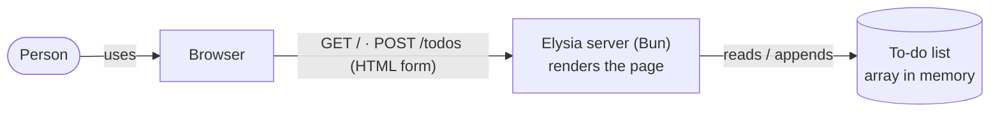
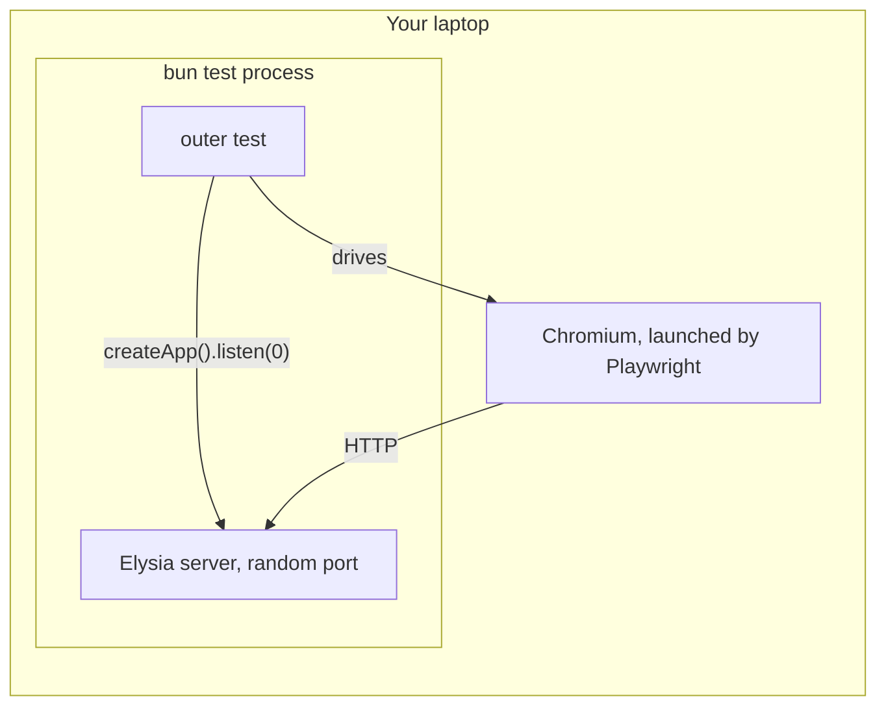
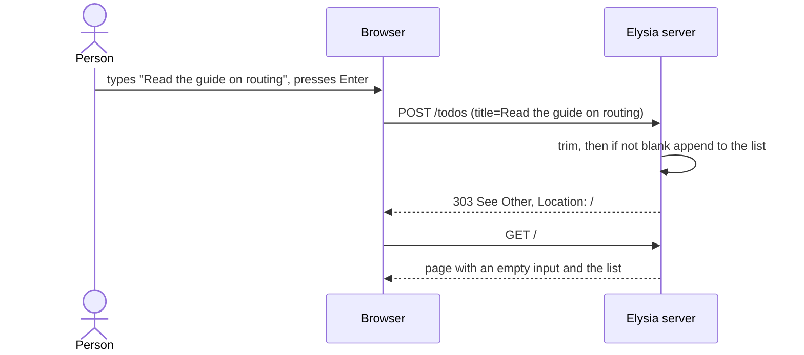

## Context

The repo has no app code yet — only planning docs and the agent tooling. This change builds the
first slice of TodoMVC (see `proposal.md`): one shared list where a person adds to-dos and sees them
in order (`specs/todo-list/spec.md`). The stack is fixed: Bun 1.4.2, Elysia, `bun test`; outer
acceptance tests drive the real app in a browser with Playwright. Everything else arrives in the step
whose test needs it. There are no ADRs yet (`adr/` does not exist).

- **One runnable unit:** the Elysia server. The browser receives plain HTML; there is no browser
  JavaScript.
- **The list lives in the server's memory**, so every page load sees it (reload works) and a restart
  empties it (accepted — "Not yet" in the proposal).
- **Assumption:** the app runs locally (`bun run`); nothing is deployed in this step.

## Goals / Non-Goals

**Goals:**
- Pass every scenario in `specs/todo-list/spec.md`, ending with the "Done when" script driven in a
  real browser.
- The smallest design that does so, with each piece arriving with the test that needs it.

**Non-Goals** (the proposal's "Not yet" list):
- Keeping to-dos across a server restart.
- Separate lists per person.
- Completing, editing, deleting or filtering to-dos, and every other TodoMVC feature.
- Escaping HTML in a to-do's text — agreed during design; a known gap until a later step.

## Decisions

### 1. Server-rendered HTML with a plain form
`GET /` returns the whole page: an input inside `<form method="post" action="/todos">` and the list
as `<ul>` / `<li>`. Pressing Enter in a form's only text input submits it — the browser does this
without any script.

- **Why:** it is the direction this repo's `CLAUDE.md` names ("server-rendered HTML first"), and it
  makes two spec behaviours free: the input is empty after an add (the page is new), and reload shows
  the list (the server renders it each time).
- **Alternative — JSON API + browser JavaScript:** needs client code to send the to-do, clear the
  input and redraw the list, plus a second kind of test. Nothing in this step needs it; it arrives
  with a later step (React is its own step).

### 2. Post, then redirect, then show the page (POST → 303 → GET)
`POST /todos` adds the to-do and answers `303 See Other` to `/`; the browser then loads `/`.

- **Why:** after a redirect, reloading repeats the `GET`, not the `POST` — so the reload scenario
  shows the list without adding the to-do again.
- **Alternative — `POST` answers with the page directly:** reload would ask to resubmit the form and
  add a duplicate.

### 3. Trimming and the blank check on the server, plus `required` on the input
The `POST /todos` handler trims the text, then ignores it if it is empty; either way it redirects to
`/`. The input also has the HTML `required` attribute, so the browser itself refuses an empty submit
and asks the person to fill in the field.

- **Why:** the server is where the rule lives — trim first, then check — so it holds for every
  request, including `"   "`, which `required` lets through. `required` adds the browser's own
  prompt for the plainly empty case, with no JavaScript.
- **Alternative — server only:** simpler, one place; but an empty Enter gives the person no sign
  that anything was refused.
- **Consequence:** in the browser, the empty-entry scenario is answered by `required`, not by our
  server; the server's empty-path is covered by an inner test that posts `""` directly. No scenario
  checks the browser's prompt (agreed during design), so `required` arrives with its reason stated
  in the commit that adds it, like config no test can drive.

### 4. The list belongs to an app built by a function
`createApp()` returns a new Elysia app holding its own array. The server entry point
(`src/server.ts`) calls it once and listens on a port; each test calls it to get a fresh, empty list.

- **Why:** tests cannot leak to-dos into each other, and inner tests can call
  `app.handle(new Request(...))` with no port and no browser.
- **Alternative — a module-level array:** shared by every test in the process; order-dependent tests.

### 5. The page as JSX in its own file, with `@elysiajs/html`
The page is a component in its own file (`src/todo-list-page.tsx`, named `TodoListPage` after what it
shows), rendered with the `@elysiajs/html` plugin.
The plugin and the `tsconfig` JSX settings arrive with the first test that renders the page.

- **Why:** markup in its own file gets what a string loses — syntax highlighting, formatting,
  folding and type checks in the editor — and this page grows with every TodoMVC step. Inline
  strings are only for very small snippets.
- **Alternative — template strings in TypeScript:** no dependency, but the markup is an unhighlighted,
  unformatted string.
- **Escaping:** the plugin (Kita HTML) escapes only elements marked `safe`. This step uses no `safe`,
  so the escaping gap stays a visible Non-Goal until the step that adds it with its own test.

### 6. Tests: Playwright as a library under `bun test`
The outer test starts `createApp().listen(0)` (port 0 = any free port), launches Chromium with the
`playwright` library, and follows the "Done when" script. It finds elements the way a person does —
the input by its placeholder "What needs to be done?" (TodoMVC's wording), to-dos as list items —
not by CSS class. Both levels are written in the feather-testing-core DSL (0.7.0-beta.1): the outer
test drives the browser with its Playwright adapter, `createSession(page, { baseUrl })`; inner tests
use its request adapter, `createSession(createApp().handle)`, which sends requests to `app.handle`
with no browser, parses each response (happy-dom) and follows forms and redirects as a browser would.
The same chain of steps (`visit`, `assertValue`, `refuteHas`, …) reads the same at both levels. One
difference shows up already: the browser judges visibility by layout (an empty `<ul>` is "hidden"),
the request adapter by markup, so outer tests check "no list items" rather than "a list exists".

Waiting is the DSL's job: its assertions retry until their timeout, and `submit()` / `pressKey("Enter")`
wait for the page a post redirects to — so no hand-written reload-wait helper is needed. The server code lives in its own module (`src/app.ts`), not in a test file — Bun
leaves test files out of coverage.

- **Why:** one runner and one process. Each test gets a fresh app from `createApp()` (decision 4);
  the outer test's work counts towards `bun test --coverage` and towards Stryker at reconcile; Bun
  is the only runtime. A free port lets test files run in parallel.
- **Alternative — `@playwright/test`'s runner for the outer test:** retrying assertions, trace
  viewer, HTML report and UI mode out of the box. But its `webServer` starts one server for the whole
  run (one shared list across tests, needing a test-only reset route), the server runs in another
  process (invisible to coverage and Stryker), and the runner officially needs Node. Worth revisiting,
  with its own ADR, when there are many browser tests, several browsers, or CI debugging.

## Risks / Trade-offs

- [A restart empties the list] → accepted for this step; listed as "Not yet" in the proposal.
- [Playwright needs a browser download (Chromium, ~100+ MB)] → installed once with the outer test,
  as a `chore:` commit recording the exact command.
- [Text is written into HTML unescaped, so `<b>hi</b>` renders as bold and a `<script>` runs for
  everyone viewing the shared list] → accepted for this step (a Non-Goal); a later step adds
  escaping with its own scenario.
- [The `playwright` library under Bun] → a throwaway spike (22-Oct-2026: Elysia 1.4.30,
  playwright 1.64.1, headless Chromium) ran the "Done when" script plus a no-leak test with no
  failure — 13 runs on Bun 1.3.9, then 5 on Bun 1.4.2 — and browser-driven server code counted
  towards coverage on both. If the real outer test disagrees, a `design:` commit revisits decision 6.
- [Checks that run before the reload finishes make tests flaky] → the wait-for-reload helper in
  decision 6.
- [One shared list in the server process] → fine for one person on one machine; tests stay isolated
  through `createApp()`.

## Migration Plan

None — there is nothing to migrate and nothing is deployed. The app is started locally with
`bun run src/server.ts`; rollback is reverting the commits.

## Open Questions

1. **Which decisions become ADRs** — settled during design: two ADRs for the adr step.
   - Decisions 1 and 2 together: a server-rendered page with a plain form and post-redirect-get, no
     browser JavaScript — it shapes every later step until React arrives.
   - Decision 6: Playwright as a library under `bun test`, not its own runner — many trade-offs
     (retrying assertions, traces vs. a fresh app per test, coverage, Stryker, one runtime), so the
     reasons are recorded.
   Decisions 3–5 stay in this design.
